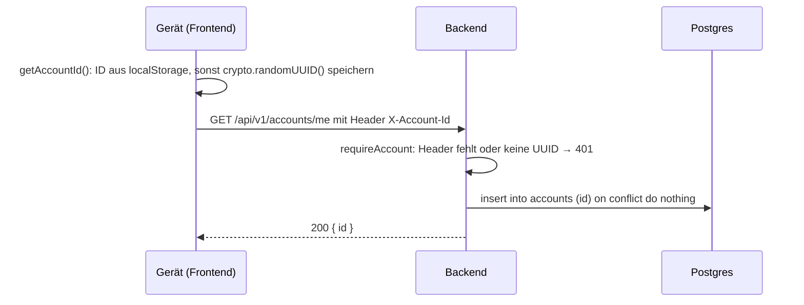

# Ablauf: Konto anlegen

Anonymes Konto ohne Registrierung. Bewusst unsichere PoC-Lösung, nur für Testdaten. Überarbeitung erfolgt in #145.

Claude Generiertes Sequenzdiagram:

1. **App öffnen:** `main.tsx` ruft beim Start einmal `GET /api/v1/accounts/me` auf.
2. **ID holen:** `getAccountId()` (`apps/frontend/src/lib/account-id.ts`) liest die ID aus `localStorage["accountId"]`. Gibt es noch keine, erzeugt es mit `crypto.randomUUID()` eine neue und speichert sie.
3. **ID mitschicken:** Der API-Client (`apps/frontend/src/api.ts`) hängt an jede Anfrage den Header `X-Account-Id`.
4. **Prüfen:** Die Middleware `requireAccount` (`src/middleware/require-account.ts`) antwortet mit 401, wenn der Header fehlt oder keine UUID ist.
5. **Anlegen:** Dieselbe Middleware legt über Drizzle eine Zeile in `accounts` an (`id`, `created_at`). Gibt es die ID schon, passiert nichts. Das Konto entsteht also bei der ersten Anfrage, jede weitere nutzt es nur.
6. **Weiter:** Die Route liest die ID mit `c.get("accountId")`.

Endpunkte mit Kontodaten hängen `requireAccount` vor, z. B. `.get("/x", requireAccount, handler)`.

## Löschen

`DELETE /api/v1/accounts/me` löscht die Zeile in `accounts`.
Alle abhängenden Daten werden ebenfalls gelösscht, da wir `cascade` benutzen.

## Bekannte Schwächen für den der #145 dann implementiert

- Die ID ist zugleich das Passwort. Sie steht in der DB und eventuell in Logs.
- Per XSS lässt sich `localStorage` auslesen.
- Webbrowser löschen den `localStorage` nach 7 Tagen ohne Nutzung, wenn die App nicht installiert ist.
